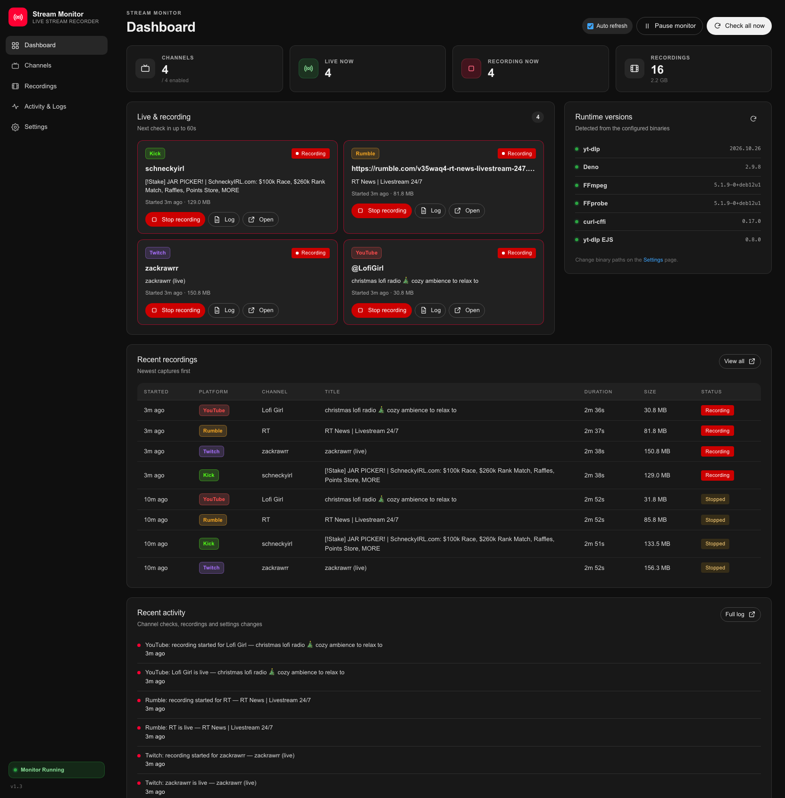
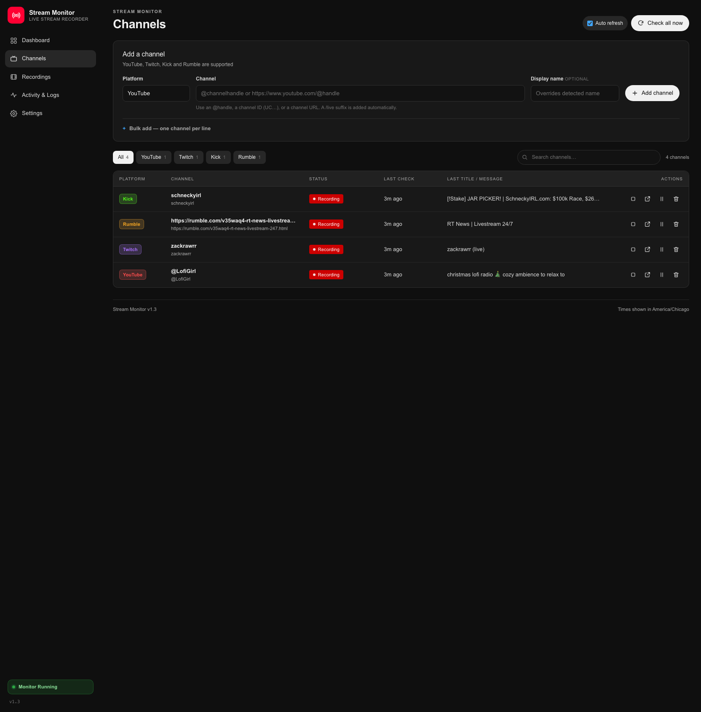
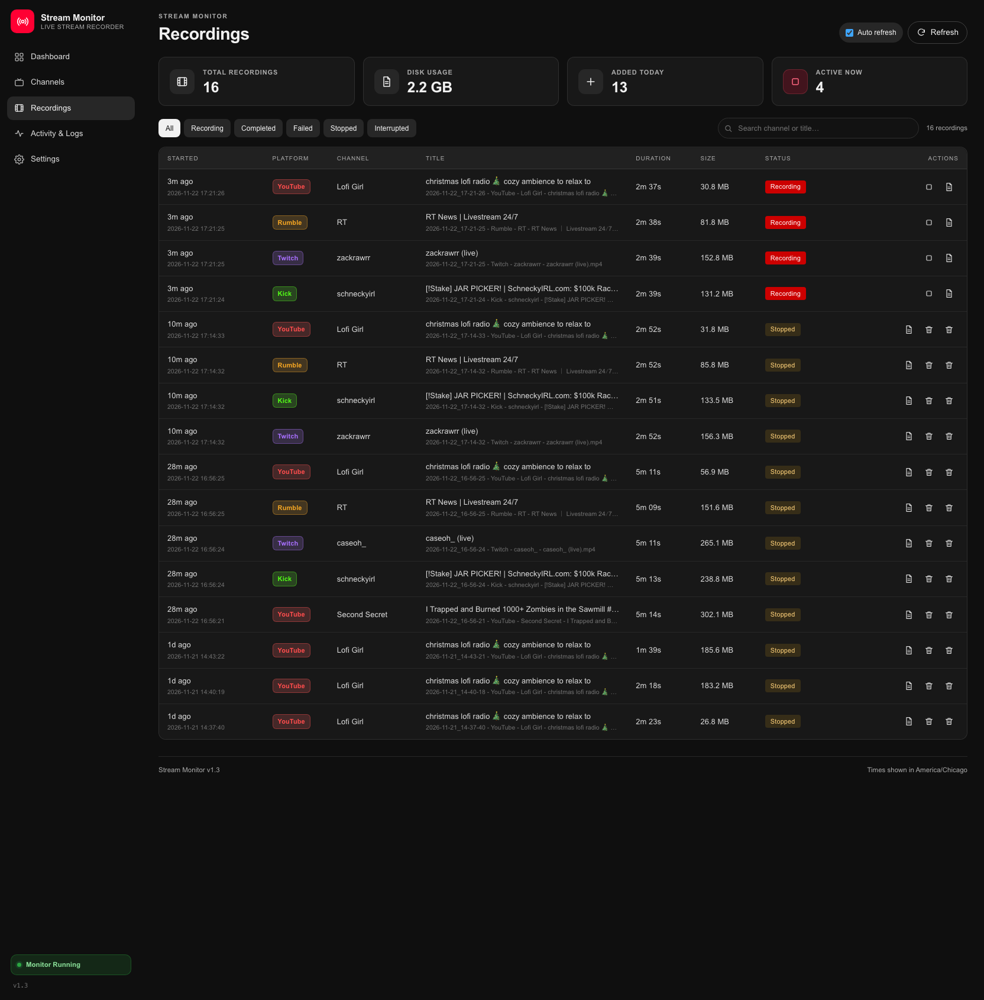
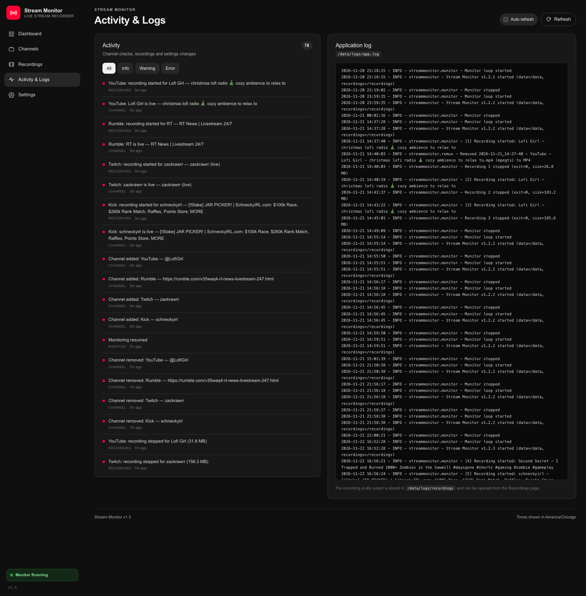
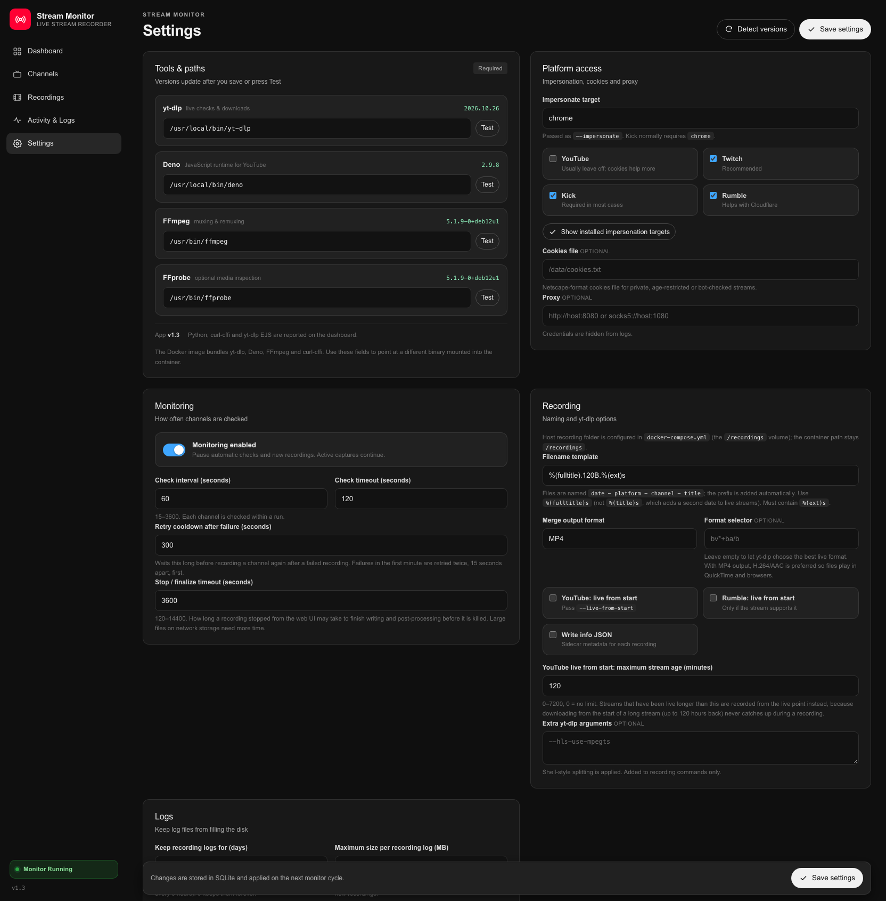

# Stream Monitor

[](https://github.com/mo-aamin/stream-monitor/pkgs/container/stream-monitor)
[](https://github.com/mo-aamin/stream-monitor/pkgs/container/stream-monitor)

**Self-hosted live-stream recorder for YouTube, Twitch, Kick and Rumble.**

Stream Monitor watches the channels you add and records their live streams
automatically with [yt-dlp](https://github.com/yt-dlp/yt-dlp). It runs as a
single Docker container — web UI, SQLite database, background monitor, and the
whole recording pipeline included. No cloud service, no external database, and
no Python, FFmpeg, Deno or yt-dlp to install on the host.

Recordings are written straight to a folder you control.

---

## Features

- **Set and forget** — add a channel once; every live stream is recorded as it starts.
- **Four platforms** — YouTube, Twitch, Kick and Rumble.
- **One container** — FFmpeg, Deno, yt-dlp and `curl-cffi` are bundled in the image.
- **Your files** — video recordings (MP4 by default) plus a plain SQLite database on your own disk.
- **Web UI** — dashboard, channels, recording history, per-recording logs and settings.
- **Multi-architecture** — runs natively on `linux/amd64` and `linux/arm64`.
- **Simple stack** — one container, one SQLite file, no message broker.

---

## Screenshots

A look at the main views. Click any image to open it full size.

**Dashboard** — live channels, active recordings, recent captures and runtime versions.

<a href="screenshots/screenshot1.png"></a>

**Channels** — add channels individually or in bulk, with per-platform status.

<a href="screenshots/screenshot2.png"></a>

**Recordings** — recording history with status, duration, size, filters and actions.

<a href="screenshots/screenshot3.png"></a>

**Activity & Logs** — channel checks, settings changes and the application log.

<a href="screenshots/screenshot4.png"></a>

**Settings** — tool paths, platform access, monitoring interval and recording options.

<a href="screenshots/screenshot5.png"></a>

---

## Quick start

You need Docker with the Compose v2 plugin (`docker compose version`), and a
host that stays awake — a Linux server, NAS, or always-on mini PC. Docker
Desktop on a laptop works for testing, but it pauses when the machine sleeps.

### 1. Create the folders

```bash
sudo mkdir -p /opt/stream-monitor/data
sudo mkdir -p /opt/stream-monitor/recordings
```

### 2. Save the Compose file

Save this as `/opt/stream-monitor/docker-compose.yml`:

```yaml
services:
  stream-monitor:
    image: ghcr.io/mo-aamin/stream-monitor:latest
    container_name: stream-monitor
    restart: unless-stopped
    environment:
      - TZ=America/Chicago
    ports:
      - "8080:8080"
    volumes:
      - /opt/stream-monitor/data:/data
      - /opt/stream-monitor/recordings:/recordings
    logging:
      driver: json-file
      options:
        max-size: "10m"
        max-file: "3"
```

The `logging` block caps Docker's own copy of the container output at about
30 MB. Without it, Docker's default log driver grows forever. If you use
`docker run` instead of Compose, pass
`--log-opt max-size=10m --log-opt max-file=3`, or set the same defaults for
every container in the host's `/etc/docker/daemon.json`.

### 3. Start it

```bash
cd /opt/stream-monitor
sudo docker compose up -d
```

### 4. Open the web UI

Browse to **`http://<server-ip>:8080`**, open **Channels**, and add a channel
name, `@handle`, or URL. The first live check runs immediately.

> **Port already in use?** Change the left side of the mapping, for example
> `"8000:8080"`, then run `sudo docker compose up -d` again.
>
> **Firewall?** Allow the port if needed, e.g. `sudo ufw allow 8080/tcp`.

---

## Updating the image

New images are published to GitHub Container Registry
(`ghcr.io/mo-aamin/stream-monitor`). To pick up the latest one:

```bash
cd /opt/stream-monitor
sudo docker compose pull
sudo docker compose up -d
```

That is the whole update. `pull` downloads the new image and `up -d` recreates
the container only if the image changed. Your `data` and `recordings` folders
are bind mounts, so they are untouched.

> `docker compose restart` and `docker compose up -d` **without** `pull` will
> keep running the old image. Always pull first.
>
> Recreating the container stops it. If a recording is in progress, allow the
> shutdown grace period to finish muxing — or update when nothing is recording.

> **Moving from Docker Hub?** Images are no longer published to
> `moamin1/stream-monitor`. Change the `image:` line in your
> `docker-compose.yml` to `ghcr.io/mo-aamin/stream-monitor:latest`, then run
> the `pull` and `up -d` commands above. Your `data` and `recordings` folders
> are unaffected.

Verify what is running:

```bash
sudo docker compose images
curl -fsS http://localhost:8080/healthz
```

The `/healthz` response reports the application version and monitor state. The
version string only changes between releases; the image digest is the reliable
way to confirm a new build.

---

## Where your data lives

| Host path | Container path | Contents |
| --- | --- | --- |
| `/opt/stream-monitor/data` | `/data` | SQLite database, application log, per-recording yt-dlp logs |
| `/opt/stream-monitor/recordings` | `/recordings` | Recorded video files |

**Log size is bounded.** The application log (`app.log`) rotates at 2 MB and
keeps 3 older copies. Per-recording yt-dlp logs are capped at 10 MB each and
are deleted after 30 days; both limits can be changed under
**Settings → Logs** (set the retention to `0` to keep them forever). Deleting
a recording entry also deletes its log. Video files are never removed
automatically.

**Backups:** stop the container before copying `data` (or use SQLite's online
backup). The `recordings` folder can be copied at any time; an active file may
end in `.part`.

To reset everything, stop the container and remove both folders. The database
is recreated on the next start.

---

## Configuration

Environment variables in the Compose file:

| Variable | Default | Purpose |
| --- | --- | --- |
| `TZ` | `UTC` | Timezone for UI timestamps and recording filenames. |
| `PUID` / `PGID` | `1000` | Runtime user/group for the mounted folders. |
| `MONITOR_AUTOSTART` | `true` | Start the monitor loop when the container starts. |
| `LOG_LEVEL` | `INFO` | Application log level (`DEBUG`, `INFO`, `WARNING`, `ERROR`). |
| `DATA_DIR` | `/data` | Database and log location inside the container. |
| `RECORDINGS_DIR` | `/recordings` | Recording location inside the container. |

Everything else — yt-dlp options, cookies file, proxy, check interval, filename
template, format selector — is configured in the web UI under **Settings**.

### Permissions

The container drops privileges to `PUID:PGID` (default `1000:1000`). If the app
cannot write to `/opt/stream-monitor`, add these lines to the service's
`environment` list and use your host user's IDs:

```yaml
    environment:
      - TZ=America/Chicago
      - PUID=1000
      - PGID=1000
```

Use `id -u` and `id -g` on the host to find your values, then
`sudo chown -R <PUID>:<PGID> /opt/stream-monitor` if needed.

---

## Platform notes

| Platform | What you can add | Notes |
| --- | --- | --- |
| **YouTube** | `@handle`, `UC…` channel ID, or URL | Deno and yt-dlp's EJS support are bundled. Cookies help if YouTube asks for sign-in or a bot check. |
| **Twitch** | Channel name or URL | Browser impersonation is enabled by default; cookies help with subscriber-only streams. |
| **Kick** | Channel name or URL | Requires browser impersonation, enabled by default and backed by `curl-cffi`. |
| **Rumble** | Channel name, `c/name`, `user/name`, or URL | Live streams are resolved from the channel's `/live` page; a direct live video URL also works. |

Recordings are **not** playable or downloadable through the web UI. Browse the
`recordings` folder on the host, or point it at a NAS mount.

Optional: mount a Netscape-format `cookies.txt` read-only and set its path in
**Settings → Cookies file**.

---

## Security

**Stream Monitor has no built-in authentication.** Every page and API endpoint
is open to anyone who can reach the port. Run it on a trusted LAN, behind a VPN,
or behind an authenticating TLS reverse proxy. Do not expose it directly to the
internet.

The app only accepts channel URLs for the four supported platforms, and file
deletion is confined to the mounted recordings directory.

---

## Troubleshooting

| Symptom | Check |
| --- | --- |
| Container keeps restarting | `sudo docker compose logs --tail=100 stream-monitor` |
| Page does not load | Port mapping, host firewall, and `sudo docker compose ps` |
| `permission denied` in logs | Set `PUID`/`PGID` to the folder owner and `chown` the host folders |
| A channel always errors | Open its recording log; check the tool paths in **Settings → Tools** |
| YouTube bot check | Add a cookies file in Settings |
| Kick/Rumble returns 403 | Try cookies or a proxy in Settings |
| New image did not apply | Run `pull` then `up -d`; `restart` alone does not update |
| Database is locked | Run only one container against a given `data` folder |

Health endpoint: `GET /healthz` on port `8080` inside the container.

---

## Image tags

| Tag | Source | Architecture |
| --- | --- | --- |
| `latest` | `main` branch | `linux/amd64`, `linux/arm64` |
| `dev` | `dev` branch — preview build | `linux/amd64`, `linux/arm64` |
| `sha-<short>` | Every build, immutable | `linux/amd64`, `linux/arm64` |
| `1.0`, `1.2.0`, … | Git release tags (`v1.0`, `v1.2.0`) | `linux/amd64`, `linux/arm64` |

Use `latest` for normal deployments. For reproducible installs, pin a version
tag, a `sha-…` tag, or a digest instead of `latest`.

---

## Changelog

### v1.2.3 — 2026-11-22

- **More time to finalize stopped recordings.** A recording stopped from the
  web UI now gets up to 60 minutes (previously about 2 minutes) to finish
  writing and post-processing (remuxing) before it is killed, so large
  recordings on network storage finish properly. The Stop button now returns
  right away while the recording finishes in the background. The limit can be
  changed under **Settings → Stop / finalize timeout**.
- **YouTube "live from start" recordings keep video and audio in step.**
  yt-dlp downloads video and audio separately from the start of the stream,
  and stopping early left one track much longer than the other (for example
  27 minutes of video with 75 minutes of audio). Recordings are now cut to the
  shorter track, so the picture never freezes while audio plays on. Streams
  that have been live longer than **Settings → YouTube live from start:
  maximum stream age** (default 120 minutes) are recorded from the live point
  instead, since downloading from the start of a long stream never catches up.
- **Faster recovery from failed starts; retry cooldown enforced.** YouTube
  occasionally rejects a new stream link for a few seconds, which made a
  recording fail right away with "The downloaded file is empty". A recording
  that fails within its first minute is now retried after 15 seconds (up to
  twice). After that, **Settings → Retry cooldown** is now respected even
  while the channel stays live; previously every live check cleared it.

### v1.2.2 — 2026-11-20

- **YouTube recordings play again.** Without "live from start", YouTube is
  recorded by ffmpeg as MPEG-TS inside an `.mp4` file, and yt-dlp never
  converts it, so QuickTime/Safari could not open it. The app now checks each
  finished recording and converts any MPEG-TS or leftover `.part` file into a
  playable MP4. Stopping a recording also lets yt-dlp shut down ffmpeg
  cleanly instead of interrupting both at once.

### v1.2.1 — 2026-11-20

- **More reliable YouTube recordings.** YouTube streams are no longer
  recorded with `--live-from-start` by default; recording now begins from
  the live point. You can turn it back on under **Settings → YouTube: live
  from start**.

### v1.2 — 2026-11-19

- **Logs no longer grow without limit.** Recording logs older than 30 days
  are deleted automatically, along with logs left behind by deleted
  recordings. Each recording log also stops growing at 10 MB.
- **New Logs section in Settings.** Change how long recording logs are kept
  (`0` keeps them forever) and the maximum size of each log. Video files are
  never deleted automatically.
- **Smaller container log.** Successful `/healthz` checks are no longer
  written to the access log, and the Compose file now caps Docker's log at
  about 30 MB (10 MB × 3 files).
- **Database upkeep.** The database is tidied once a day and compacted when a
  lot of free space has built up.

### v1.1 — 2026-11-18

- **YouTube recordings play everywhere.** YouTube serves VP9 video by
  default, which QuickTime, Safari and many other players cannot open when it
  is saved as MP4. With MP4 output, recordings now prefer H.264 video and AAC
  audio. If a stream has no H.264 version, the best available format is still
  recorded.
- **Cleaner file names.** Recordings are now named
  `date - platform - channel - title.mp4` on every platform. The video ID
  (e.g. `[1ElaY9NmAVg]`) is gone, and so is the second date that yt-dlp
  appended to live-stream titles. Installs still using the old default
  filename template are updated automatically; custom templates are kept.
- **Correct status at the end of a stream.** A recording that ends with a
  harmless yt-dlp error (such as `Did not get any data blocks`) but still
  produces a complete file is now marked **completed** instead of **failed**.
  The message is noted in the recording log.
- **Rumble user channels work.** Rumble keeps channels (`rumble.com/c/name`)
  and user accounts (`rumble.com/user/name`) separate, and a bare name was
  always treated as `/c/`. Accounts such as `BonginoReport` failed with
  `HTTP 403` / `HTTP 410`. If one form is not found, the other is now tried
  automatically and the working URL is saved on the channel. A name that
  exists in neither form now shows a clear "channel not found" error.

### v1.0

- Initial release.

---

Built with FastAPI, SQLite, yt-dlp, FFmpeg and Deno.
